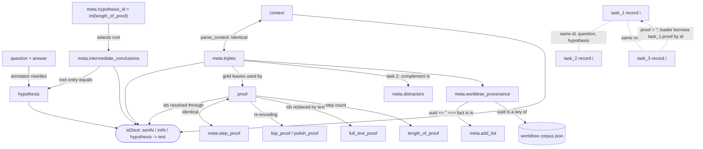
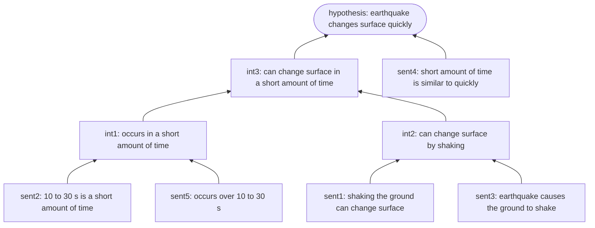

# EntailmentBank v3 — schema, data dictionary and dependency map

How the raw EntailmentBank release (`entailment_trees_emnlp2021_data_v3`) becomes the repo's
`Example` and `ReasoningChain` objects, what every field contains, and what depends on what.

* **Machine-readable:** JSON Schema (draft 2020-12) in [`docs/schemas/`](schemas/) — see [§10](#10-files-and-reproduction).
* **Numbers** below come from [`scripts/profile_entailmentbank.py`](../scripts/profile_entailmentbank.py)
  (full output: [`schemas/entailmentbank_stats.json`](schemas/entailmentbank_stats.json)).
  Every raw record, `Example` and `ReasoningChain` validates against the schemas
  ([`scripts/build_entailmentbank_schemas.py`](../scripts/build_entailmentbank_schemas.py)).
* **Code inspected:** [`datasets/entailmentbank.py`](../src/reasoning_trajectories/datasets/entailmentbank.py),
  [`datasets/base.py`](../src/reasoning_trajectories/datasets/base.py) (`Example`),
  [`reasoning/chain.py`](../src/reasoning_trajectories/reasoning/chain.py) (`Step`, `ReasoningChain`, `DonorPool`),
  [`datasets/perturbations.py`](../src/reasoning_trajectories/datasets/perturbations.py),
  [`reasoning/generate.py`](../src/reasoning_trajectories/reasoning/generate.py).

**Reading guide.** Two different kinds of dependency are easy to conflate, so they are kept apart:

| | **Data-field dependency** (§5) | **Logical dependency** (§6) |
|---|---|---|
| Relates | fields, records, files, ID namespaces | statements (sentences) inside one proof |
| Question it answers | "which field is derived from / must agree with which?" | "which conclusion needs which premises?" |
| Structure | a small, fixed DAG over *field names* | a per-record DAG over *sentences*; shape varies by record |
| Broken by | schema drift, wrong joins, ID collisions | corrupted premises/conclusions, reordered steps |
| Lives in | raw JSON + loader code | `proof` string → `Step.premise_ids` / `conclusion_id` |

---

## 1. Dataset at a glance

| | train | dev | test | total |
|---|---:|---:|---:|---:|
| records (per task) | 1,313 | 187 | 340 | **1,840** |
| unique `id` | 1,308 | 187 | 339 | **1,834** (6 ids occur twice, see [§9](#9-issues-that-affect-the-loader)) |

The three tasks describe the **same 1,840 questions**, row-for-row aligned (same `id`, `question`,
`hypothesis` at the same line index in all three tasks: 1,840/1,840). They differ only in what the model is shown:

| Task | `context` shown | Gold `proof` | Notes |
|---|---|---|---|
| **task_1** | gold leaf sentences only (2–17, median 4) | yes | `distractors` always `[]` |
| **task_2** | exactly 25 sentences = gold + 8–24 distractors (median 21) | yes (leaf ids renumbered into the 25-sentence context) | gold is 17.6 % of context on average, uniformly placed (mean index 12.96/25) |
| **task_3** | exactly 25 corpus-retrieved sentences | **empty string** | gold leaves only partly present (see [§9](#9-issues-that-affect-the-loader)); `task_3/all.jsonl` = train+dev+test |

Plus one supporting file, `worldtree_corpus_sentences_extended.json` (11,941 sentences).
Questions come from 33 exam families (`Mercury` 1,045 = 57 %, `MCAS` 181, `NYSEDREGENTS` 166, `TIMSS` 71, …);
the source mix is nearly identical across splits (Mercury 56.6 / 54.5 / 58.8 % in train / dev / test).

---

## 2. Hierarchical schema

`●` always present · `○` absent in that task · `[…]` array · `{*}` object with variable keys.
Within a task **no key is ever missing** from any record (checked on all 1,840), so "optional" in the raw data
means *absent from a task* or *allowed to be empty* (marked `∅`).

```
record                                                         task:  1  2  3
├─ id ................ string                                          ●  ●  ●
├─ context ........... string  "sent1: <text> sent2: <text> …"         ●  ●  ●
├─ question .......... string                                          ●  ●  ●
├─ answer ............ string  (short free-text answer, not a choice)  ●  ●  ●
├─ hypothesis ........ string  (declarative form; proof root)          ●  ●  ●
├─ proof ............. string  "sent1 & sent2 -> int1: …; … -> hypothesis;"   ●  ●  ●(always "")
├─ full_text_proof ... string  " [BECAUSE] a [AND] b [INFER] int1: …"  ●  ●  ○
├─ depth_of_proof .... integer ≥ 0   (annotator-reported, unreliable)  ●  ●  ○
├─ length_of_proof ... integer ≥ 1   (= number of steps)               ●  ●  ○
└─ meta ............. object
   ├─ question_text .. string  (== question)                           ●  ●  ●
   ├─ answer_text .... string  (== answer)                             ●  ●  ●
   ├─ triples ........ {sentN: string}   task1: gold leaves; task2/3: all 25 context sentences   ●  ●  ●
   ├─ core_concepts .. [string] ∅(3 records)                           ●  ●  ●
   ├─ worldtree_provenance                                             ●  ●  ●
   │    task 1,2:  {sentN: {uuid: string ∅, original_text: string}}   (gold leaves only)
   │    task 3:    [{sid: sentN, uuid: string ∅, relevance_score: number}]   (all 25 sentences — an ARRAY)
   ├─ hypothesis_id .. string "intN"  (always int{length_of_proof})    ●  ●  ○
   ├─ intermediate_conclusions {intN: string}  (one per step, incl. root)   ●  ●  ○
   ├─ distractors .... [sentN]        task1: always [] · task2: 8–24 ids   ●  ●  ○
   ├─ distractors_relevance [number]  parallel to distractors            ●  ●  ○
   ├─ step_proof ..... string  (== proof)                              ●  ●  ○
   ├─ lisp_proof ..... string  "((((sent1 sent3) -> int1) sent2) -> int2)"   ●  ●  ○
   ├─ polish_proof ... string  "# int2 & # int1 & sent1 sent3 sent2"   ●  ●  ○
   ├─ add_list ....... [{sid: sentN, fact: string}] ∅(670 records)     ●  ●  ○
   └─ delete_list .... [{uuid: string, fact: string}]  (6–34 per record, median 20)   ●  ●  ○
```

Task 3 therefore lacks 3 top-level keys and 9 `meta` keys relative to tasks 1/2 (and `worldtree_provenance` changes shape).
`additionalProperties: false` is set everywhere in the JSON Schemas, so any new key in a future release is flagged.

### Running example (`MSA_2015_5_8`, depth 3 / 4 steps / 5 leaves)

```jsonc
{
  "id": "MSA_2015_5_8",
  "context": "sent1: shaking the ground of the earth can change earth's surface sent2: 10 to 30 seconds is a short amount of time sent3: an earthquake causes the ground to shake sent4: in a short amount of time is similar to quickly sent5: an earthquake usually occurs over a period of 10 to 30 seconds",
  "proof": "sent2 & sent5 -> int1: an earthquake usually occurs in a short amount of time; sent1 & sent3 -> int2: an earthquake can change earth's surface by shaking the ground; int1 & int2 -> int3: an earthquake can change earth's surface in a short amount of time; int3 & sent4 -> hypothesis; ",
  "length_of_proof": 4,
  "meta": {
    "hypothesis_id": "int4",
    "step_proof": "<identical to proof>",
    "lisp_proof":   "((((((sent2 sent5) -> int1) ((sent1 sent3) -> int2)) -> int3) sent4) -> int4)",
    "polish_proof": "# int4 & # int3 & # int1 & sent2 sent5 # int2 & sent1 sent3 sent4",
    "intermediate_conclusions": { "int1": "…", "int2": "…", "int3": "…", "int4": "an earthquake changes earth 's surface quickly" }
  }
}
```

The same proof appears five ways (`proof`, `step_proof`, `lisp_proof`, `polish_proof`, `full_text_proof`);
see [§5](#5-data-field-dependencies). Note the root is `hypothesis` in `proof` but `int4` in `lisp_proof`/`polish_proof`/`full_text_proof`.

---

## 3. Data dictionary — raw records

Distribution columns are over all 1,840 task-1 records unless stated. "words" = whitespace tokens.

### 3.1 Top-level fields

| Field | Type | Tasks | Example | Distribution / notes |
|---|---|---|---|---|
| `id` | string | 1 2 3 | `Mercury_SC_401371` | `<exam>_<year>_<grade>_<n>`; **not unique** (6 duplicates). Same set in all tasks. |
| `context` | string | 1 2 3 | `sent1: the sun rising / setting occurs once per day sent2: …` | task 1: 1–17 sentences (median 4, p95 9); task 2 and 3: always 25. Single line; no newline. Always starts `sent1: `. |
| `question` | string | 1 2 3 | `Which event occurs on a daily cycle?` | median 14 words, mean 17.6, p95 38, max 107. Some are multi-sentence passages + question. 1 question text occurs in two splits. |
| `answer` | string | 1 2 3 | `The Sun rises and sets.` | median 3 words (1–22). One answer is a single character. |
| `hypothesis` | string | 1 2 3 | `the sun rising and setting is the event that occurs once per day` | lowercase, no final period. median 11 words (3–30). 28 hypothesis texts occur in two splits. |
| `proof` | string | 1 2 3 | `sent1 & sent2 & sent3 -> hypothesis; ` | grammar in [§4](#4-proof-encodings). Task 3: `""` for all 1,840. |
| `full_text_proof` | string | 1 2 | ` [BECAUSE] … [AND] … [INFER] int1: …` | median 73 words, p95 233, max 542. Number of `[INFER]` = `length_of_proof` (1,840/1,840). |
| `depth_of_proof` | integer | 1 2 | `3` | values 0–12; median 2. Disagrees with depth recomputed from `proof` in 46 records ([§9](#9-issues-that-affect-the-loader)). |
| `length_of_proof` | integer | 1 2 | `4` | = number of `;`-separated steps in all 1,840. Median 2, mean 3.20, p95 8, max 17. |
| `meta` | object | 1 2 3 | — | see below |

### 3.2 `meta`

| Field | Type | Tasks | Example | Distribution / notes |
|---|---|---|---|---|
| `question_text`, `answer_text` | string | 1 2 3 | — | exact copies of `question` / `answer` (1,840/1,840). |
| `triples` | `{sentN: string}` | 1 2 3 | `{"sent1": "the sun rising / setting occurs once per day", …}` | key set is `sent1…sentK` contiguous. Task 1: = parsed `context` (1,840/1,840). Tasks 2, 3: 25 entries = parsed `context`. Leaf sentences: median 8 words, p95 18, max 35; 5,358 distinct of 8,106 (`water is a kind of substance` appears 51×). Uses ` / ` as "or" (659 leaves); **task 3** uses `;` for the same marker. |
| `core_concepts` | `[string]` | 1 2 3 | `["the sun rising and setting is the event that occurs once per day"]` | 1: 1,003 · 2: 547 · 3: 221 · 4: 54 · 5+: 12 · **0: 3 records**. |
| `worldtree_provenance` | object (1,2) / array (3) | 1 2 3 | `{"sent1": {"uuid": "f8be-9407-d60e-6282", "original_text": "…"}}` | Tasks 1/2: one entry per **gold leaf** (8,106 total, also in task 2). `uuid == ""` for **2,583** entries — exactly the number of `add_list` entries (annotator-written facts). 5,514 of 5,523 non-empty uuids are keys of the supporting corpus. Leaf text equals its `original_text` for 6,779/8,106 (the rest were edited by annotators). Task 3: array over all 25 sentences, with `relevance_score` (e.g. 0.9987); `uuid == ""` in 369. |
| `hypothesis_id` | string | 1 2 | `int2` | `== "int" + str(length_of_proof)` (1,840/1,840): the root's `int` id. |
| `intermediate_conclusions` | `{intN: string}` | 1 2 | `{"int1": "…", "int2": "…"}` | 5,881 entries = total number of steps. **Includes the root** (`hypothesis_id`), whose text `==` `hypothesis` (1,840/1,840). Median 10 words (3–35). |
| `distractors` | `[sentN]` | 1 2 | `["sent7", …]` | task 1: always `[]`. Task 2: 8–24 (median 21, mean 20.6). Ids of `triples` entries that are not gold leaves. |
| `distractors_relevance` | `[number]` | 1 2 | `[-8.32, -15.90, …]` | parallel to `distractors`; range −26.7 … +31.9, mean −13.4 (task 2 train). Looks like a retrieval score; undocumented upstream. |
| `step_proof` | string | 1 2 | — | `== proof` (1,840/1,840). |
| `lisp_proof` | string | 1 2 | `((((sent1 sent3) -> int1) sent2) -> int2)` | nested S-expression; root is `intN`. |
| `polish_proof` | string | 1 2 | `# int2 & # int1 & sent1 sent3 sent2` | prefix notation. For 4 records `lisp_proof`/`polish_proof` leaf sets differ from `proof` (the 4 trees with a dangling intermediate, [§9](#9-issues-that-affect-the-loader)). |
| `add_list` | `[{sid, fact}]` | 1 2 | `[{"sid": "sent2", "fact": "earth is a kind of celestial object"}]` | 0: 670 (36 %) · 1: 500 · 2: 317 · 3: 161 · 4: 105 · 5: 35 · 6+: 52. `sid` ∈ `triples` (1,840/1,840). |
| `delete_list` | `[{uuid, fact}]` | 1 2 | `[{"uuid": "02f7-3d00-6d43-0289", "fact": "revolving is a kind of motion"}]` | WorldTree facts shown to the annotator but not used; 36,181 entries, median 20 per record (6–34). |

### 3.3 Identifier grammar

| Token | Meaning | Scope |
|---|---|---|
| `sentN` | leaf sentence N (1-based) | **per record and per task** — numbering differs between task 1, 2 and 3 for the same sentence |
| `intN` | intermediate conclusion N | per record; numbered in proof order; the root is `int{length_of_proof}` in `meta` but literally `hypothesis` in `proof` |
| `hypothesis` | the root conclusion | literal token in `proof` (final step only) |
| `SUB` | substituted slot | **not in raw data**; introduced by `ReasoningChain` corruptions |
| `uuid` | WorldTree fact id `xxxx-xxxx-xxxx-xxxx` | key into the supporting corpus; `ET_addon:N` keys are EntailmentBank additions |

### 3.4 Supporting file

`supporting_data/worldtree_corpus_sentences_extended.json` — one object `{uuid | "ET_addon:N": sentence}`;
11,941 entries (9,011 uuid-like + 2,930 `ET_addon`), median 8 words, 420 duplicate sentences, 18 non-ASCII
(`El niño …`), one placeholder `ET_addon:0 = "DUMMY"`.

---

## 4. Proof encodings

Grammar of `proof` (validated by regex on all 3,680 task-1/2 records; the `intN: text` form carries inline text for every
intermediate conclusion — 4,041 of them, all equal to `meta.intermediate_conclusions` — and never for the final step):

```
proof   := step ";" { " " step ";" } " "?
step    := premises " -> " conclusion
premises:= id { " & " id }               id := "sent"N | "int"N        (fan-in 1–5, median 2)
conclusion := "int"N ": " text | "hypothesis"
```

| Encoding | Where | Root written as | Carries |
|---|---|---|---|
| `proof` = `meta.step_proof` | top-level / meta | `hypothesis` | ids + inline text of intermediates |
| `lisp_proof` | meta | `intN` | tree nesting (S-expression); no text |
| `polish_proof` | meta | `intN` | prefix notation; no text |
| `full_text_proof` | top-level | `intN` | the whole proof with `sentN` replaced by sentence text (`[BECAUSE] … [AND] … [INFER] intN: …`) |
| `Example.meta["entailment_steps"]` | repo | `hypothesis` | list of resolved step dicts ([§7](#7-repo-objects)) |

Orderings that hold for **all 1,840** trees: the final step is the only one concluding `hypothesis`; intermediates are numbered `int1…int(n−1)` in proof order;
every `intN` premise is defined by an earlier step (no forward references); no premise token other than `sentN`/`intN`.

---

## 5. Data-field dependencies

Which field is derived from, duplicates, or must agree with which. Edges mean "recoverable from / must equal".



Checked invariants (all hold unless stated; counts are out of 1,840 records):

| # | Invariant | Result |
|---|---|---|
| D1 | `parse_context(context) == meta.triples` (tasks 1, 2, 3) | 1,840 / 1,840 / 1,840 |
| D2 | `proof == meta.step_proof` | 1,840 |
| D3 | `meta.intermediate_conclusions[hypothesis_id] == hypothesis` | 1,840 |
| D4 | `hypothesis_id == "int"+str(length_of_proof)`; `len(intermediate_conclusions) == length_of_proof` | 1,840 each |
| D5 | inline `intN: text` in `proof` equals `intermediate_conclusions[intN]` | 4,041 / 4,041 |
| D6 | every `sentN` in `proof` ∈ `triples`, every `triples` key used (task 1) | 1,840 (no unused leaf) |
| D7 | task 2: gold leaf **text set** equals the task-1 leaf text set | 1,840 — but leaf **ids** differ: `proof` strings differ in 1,837 (only 3 are textually identical because the leaves happen to be sent1…sentN already) |
| D8 | task 2: `len(context) == 25`, gold ids ∈ context and ∉ `distractors` | 1,840 |
| D9 | `depth_of_proof == depth recomputed from proof` | **1,794** (46 violations) |
| D10 | task 3: every gold leaf text present in `context` | **no** — 5,195/8,106 verbatim, 5,614/8,106 after case/punctuation normalisation; 985/1,840 trees miss ≥ 1 gold leaf |
| D11 | ids unique | **no** — 6 duplicate ids (12 records) |

**ID namespaces.** `sentN` is *not* a global key. The same fact has a different `N` in task 1, task 2 and task 3, and
`intN`/`hypothesis` are per-record. A proof can only be resolved against the id→text map of **the record it belongs to**
(that is why the loader needs the task-1 record when it borrows a task-1 proof for task 3 — see [§7.3](#73-raw---example-field-mapping)).

---

## 6. Logical dependencies within a proof

A proof is a derivation: each **step** says that a set of premise sentences jointly entails one conclusion sentence.

* **Nodes:** leaf sentences (`sentN`, given), intermediate conclusions (`intN`, derived), and one root (`hypothesis`).
* **Edges:** premise → conclusion of the step that consumes it. A *step* is the hyperedge {premises} → conclusion.
* **Step `j` depends on step `i`** iff `conclusion(i) ∈ premises(j)`. Leaves depend on nothing.
* **Constraints:** every `intN` premise is derived before use; exactly one root; the root is last in the string.



`MSA_2015_5_8`: 4 steps, depth 3, shape **branched** (step 3 joins two derived conclusions), 5 leaves.

### 6.1 Graph characteristics (task 1, n = 1,840 proofs, 5,881 steps)

Recomputed from the `proof` string (not from the unreliable `depth_of_proof` field).
**Depth** = number of steps on the longest leaf→root path; **steps** = `length_of_proof`; a **join** is a step with ≥ 2 intermediate premises.

| | train (1,313) | dev (187) | test (340) | all (1,840) |
|---|---:|---:|---:|---:|
| depth median / mean / p95 / max | 2 / 2.63 / 5 / 12 | 2 / 2.59 / 6 / 7 | 2 / 2.64 / 5 / 7 | 2 / 2.63 / 5 / 12 |
| steps median / mean / p95 / max | 3 / 3.18 / 8 / 17 | 2 / 3.19 / 9 / 15 | 2 / 3.26 / 9 / 11 | 2 / 3.20 / 8 / 17 |
| leaves median / mean / p95 / max | 4 / 4.39 / 9 / 17 | 4 / 4.36 / 10 / 15 | 4 / 4.49 / 10 / 12 | 4 / 4.41 / 9 / 17 |
| single-step | 331 | 51 | 87 | 469 (25.5 %) |
| linear | 596 | 80 | 154 | 830 (45.1 %) |
| branched | 386 | 56 | 99 | 541 (29.4 %) |

**Histograms (all splits)**

| depth | 1 | 2 | 3 | 4 | 5 | 6 | 7 | 8 | 10 | 12 |
|---|---:|---:|---:|---:|---:|---:|---:|---:|---:|---:|
| proofs | 471 | 537 | 372 | 244 | 132 | 58 | 20 | 3 | 2 | 1 |

| steps | 1 | 2 | 3 | 4 | 5 | 6 | 7 | 8 | 9 | 10 | 11 | 12 | 13 | 15 | 17 |
|---|---:|---:|---:|---:|---:|---:|---:|---:|---:|---:|---:|---:|---:|---:|---:|
| proofs | 469 | 462 | 303 | 212 | 126 | 78 | 62 | 49 | 30 | 24 | 17 | 2 | 3 | 2 | 1 |

| leaves | 1 | 2 | 3 | 4 | 5 | 6 | 7 | 8 | 9 | 10 | 11 | 12 | 13 | 14–17 |
|---|---:|---:|---:|---:|---:|---:|---:|---:|---:|---:|---:|---:|---:|---:|
| proofs | 1 | 389 | 422 | 330 | 242 | 165 | 91 | 72 | 51 | 31 | 18 | 17 | 6 | 5 |

**Shape definitions and their size profile**

| Shape | Definition | Proofs | steps median (max) | depth median (max) |
|---|---|---:|---|---|
| single-step | one step | 469 | 1 (1) | 1 (1) |
| linear | ≥ 2 steps, no join: each step consumes ≤ 1 derived conclusion (a "spine" with leaves hanging off it) | 830 | 2 (7) | 2 (7) |
| branched | ≥ 1 join: two independently derived sub-conclusions are combined | 541 | 5 (17) | 4 (12) |

**Branching and fan-in**

| Measure | Value |
|---|---|
| Premises per step (fan-in) | mean 2.10; 1: 12 · **2: 5,334 (90.7 %)** · 3: 477 · 4: 54 · 5: 4 |
| Step kinds | leaf-only 2,619 (44.5 %) · mixed leaf+derived 2,527 (43.0 %) · join (derived-only) 735 (12.5 %) |
| Joins per proof | 0: 1,299 · 1: 380 · 2: 107 · 3: 42 · 4: 9 · 5: 2 · 7: 1 |
| Leaf-only ("base") steps per proof | 1: 1,303 · 2: 368 · 3: 113 · 4: 44 · 5: 9 · 6: 2 · 8: 1 |
| Max steps at one height (width) | 1: 1,297 · 2: 372 · 3: 115 · 4: 44 · 5: 9 · 6: 2 · 8: 1 |
| Leaf distance to root (steps) | median 2, mean 2.51, max 10; 1: 2,196 · 2: 2,427 · 3: 1,711 · 4: 1,016 · 5: 476 · 6: 182 · 7+: 85 |
| Out-degree of a node | 1 for all nodes, **except** 151 proofs (8.2 %) where a node feeds ≥ 2 steps: 172 leaves and 15 intermediates are reused |

So the proofs are **DAGs, not strict trees** (EntailmentBank calls them "entailment trees"): in `AKDE&ED_2008_4_27`, `sent5` is a premise of both
`int2` and `int3`. Any code that assumes each node has a single parent (or that renders a tree by recursion without memoising) is wrong for 8 % of the data.

**Depth vs steps** (rows = recomputed depth; cell = number of proofs with that step count). Steps ≥ depth always;
steps ≈ depth means a linear chain, steps ≫ depth means width.

| depth \ steps | 1 | 2 | 3 | 4 | 5 | 6 | 7 | 8 | 9 | 10 | 11 | 12 | 13 | 15 | 17 |
|---|---:|---:|---:|---:|---:|---:|---:|---:|---:|---:|---:|---:|---:|---:|---:|
| 1 | 469 | | 2 | | | | | | | | | | | | |
| 2 | | 462 | 73 | 2 | | | | | | | | | | | |
| 3 | | | 228 | 108 | 29 | 5 | 2 | | | | | | | | |
| 4 | | | | 102 | 67 | 37 | 23 | 10 | 2 | 3 | | | | | |
| 5 | | | | | 30 | 32 | 24 | 22 | 11 | 7 | 4 | 1 | 1 | | |
| 6 | | | | | | 4 | 11 | 14 | 13 | 10 | 5 | 1 | | | |
| 7 | | | | | | | 2 | 3 | 3 | 2 | 7 | | | 1 | 1 |
| 8 | | | | | | | | | 1 | 2 | | | | | |
| 10 | | | | | | | | | | | 1 | | | 1 | |
| 12 | | | | | | | | | | | | | 1 | | |

(Depth 1 with 3 steps = the two copies of the duplicated `Mercury_SC_405304`, whose `int2` is derived but never used; see §9.)

### 6.2 What carries the logical structure in the repo

The logical DAG is **not stored as an edge list anywhere**. It is recoverable only from
`Step.premise_ids` (which `intN`/`sentN` each premise is) and `Step.conclusion_id` (which `intN` a step defines):
edge (a → b) exists iff `a ∈ steps[j].premise_ids` and `b == steps[j].conclusion_id`. Consequences:

* `ReasoningChain.premises`, `.conclusions`, `.leaves`, `.intermediates` are **flat views**; they discard the edges.
* `render_steps` prints premise **text** in step order, so the text rendering carries *positional* order but not *which earlier step* a premise comes from (premises are not labelled with ids in the rendered text).
* Corruptions act on logical structure differently from data fields:
  * `step_shuffle` permutes the step list. **All data stay intact** (same sentences, same ids) but the topological order is broken: steps now use conclusions before they are derived.
  * `premise_substitution[_other_tree]` swaps one premise text and marks its id `SUB`, so one edge now points at an unrelated sentence.
  * `conclusion_substitution` replaces a conclusion, marks it `SUB`, and **propagates** `SUB` to every later step that consumed it (`meta.corruption.propagated_to`). Because 8 % of proofs reuse nodes, propagation can touch more than one consumer.

---

## 7. Repo objects

### 7.1 Pipeline: raw → `Example` → `ReasoningChain`

```mermaid
flowchart LR
  subgraph RAW["raw release (JSONL, one record per question)"]
    R1["task_1/split.jsonl"]
    R2["task_2/split.jsonl"]
    R3["task_3/split.jsonl<br/>proof = empty"]
  end
  R1 & R2 & R3 --> RJ["_read_jsonl -> list of dict"]
  R3 -. "proof empty: also read task_1 same split,<br/>_gold_trees[id] = record (last id wins)" .-> GT["tree_rec = task_1 record"]
  RJ --> ID["build_id2text(rec)<br/>context + meta.triples + meta.intermediate_conclusions + hypothesis"]
  GT --> ID2["build_id2text(tree_rec)"]
  RJ --> PP["parse_proof_steps(proof)<br/>[{premises, conclusion_id, conclusion_text}]"]
  GT --> PP
  PP --> SP["steps_from_proof / resolve_steps<br/>{step, premise_ids, premises, conclusion_id, conclusion}"]
  ID2 --> SP
  SP --> RC["ReasoningChain.from_entailmentbank<br/>steps = [Step], fmt, source_id"]
  ID --> FB["facts_block(sent_map)<br/>'1. text' lines"]
  FB --> EX
  RC -- "chain.text" --> EX["Example<br/>id, question, choices, choice_labels, answer_key, prompt, context, meta"]
  RC -- "chain.to_dicts()" --> EX
  EX --> PC["PairedCorruption(base)<br/>_chains keyed by ex.id"]
  PC -- "chain.corrupt(kind)" --> CC["corrupted ReasoningChain"]
  CC -- "_variant(): rewrites meta.entailment_steps / reasoning / corruption" --> EX2["Example (valid | corrupted)"]
  EX2 --> RP["ReasoningProvider.chain_for<br/>ReasoningChain.from_example"]
  EX --> RP
  RP --> EXT["extraction / trajectories"]
```



Two facts about this pipeline that are easy to miss:

1. **`Example.meta["entailment_steps"]` is the persisted form; `ReasoningChain` is rebuilt from it.**
   `ReasoningChain.from_example` reads `meta["entailment_steps"]`, so the chain used downstream never sees the raw `proof`.
   Anything not copied into `Step` (`hypothesis_id`, provenance, `lisp_proof`, …) is gone after the loader.
2. **For task 3 the prompt and the steps come from different records.** `prompt`/`context` are built from the task-3 record's 25-sentence context
   (task-3 numbering, `;` separators); `entailment_steps`/`reasoning` come from the task-1 record (task-1 numbering, ` / ` separators).

### 7.2 Class reference

**`Example`** — [`datasets/base.py`](../src/reasoning_trajectories/datasets/base.py) (mutable dataclass, dataset-agnostic) · schema: [`example.schema.json`](schemas/example.schema.json)

| Field | Type | Required | EntailmentBank value |
|---|---|---|---|
| `id` | `str` | yes | raw `id`; paired corrupted variants: `<pair_id>__<kind>` |
| `question` | `str` | yes | raw `question` (falls back to `meta.question_text`, then `hypothesis`) |
| `choices` | `list[str]` | yes | `[answer]` — a single short answer, **not** a multiple-choice list (`[]` if no answer) |
| `choice_labels` | `list[str]` | yes | `["A"]` |
| `answer_key` | `str \| None` | yes (nullable) | `"A"`; `None` only if the answer is empty (never in v3) |
| `prompt` | `str` | yes | template + numbered facts + hypothesis (or question when `use_question=True`) |
| `context` | `str \| None` | no (default `None`) | `facts_block`: newline-joined `N. <sentence>` |
| `meta` | `dict` | no (default `{}`) | see 7.3; PairedCorruption adds `condition`, `pair_id`, `corruption` |
| `answer_index` *(property)* | `int \| None` | derived | `0` |

**`Step`** — [`reasoning/chain.py`](../src/reasoning_trajectories/reasoning/chain.py) (frozen dataclass) · schema: [`reasoning_chain.schema.json#/$defs/Step`](schemas/reasoning_chain.schema.json)

| Field | Type | Required | Values |
|---|---|---|---|
| `premises` | `tuple[str, ...]` | yes | sentence texts (1–5, mostly 2) |
| `conclusion` | `str` | yes | sentence text |
| `premise_ids` | `tuple[str, ...]` | no (default `()`) | parallel to `premises`: `sentN` · `intN` · `SUB` |
| `conclusion_id` | `str` | no (default `""`) | `intN` · `hypothesis` (final step) · `SUB` · `""` |
| `is_final` *(property)* | `bool` | derived | `conclusion_id == "hypothesis"` |

Serialised as a **dict with an extra `step` index** by `ReasoningChain.to_dicts()` / in `Example.meta["entailment_steps"]`
(`StepDict` in the schema): `{step: int≥1, premise_ids: [...], premises: [...], conclusion_id, conclusion}`. `Step.from_dict` ignores `step`.

**`ReasoningChain`** — mutable dataclass · schema: [`reasoning_chain.schema.json`](schemas/reasoning_chain.schema.json)

| Field | Type | Required | Notes |
|---|---|---|---|
| `steps` | `list[Step]` | yes | `[]` for opaque chains |
| `fmt` | `str` | no (`"natural"`) | `natural` · `structured` · `raw` · `text` (opaque) |
| `source_id` | `str \| None` | no | raw `id` — **the key used by `DonorPool` and `PairedCorruption`** |
| `meta` | `dict` | no | `condition`, `pair_id`, `corruption` (copied from `Example.meta`; `corruption` is `None` on the valid member) |
| `raw_text` | `str \| None` | no | set only for `from_text` chains; then `steps == []`, `fmt == "text"` |
| derived: `text`, `premises`, `conclusions`, `hypothesis`, `leaves`, `intermediates`, `is_structured` | | | `leaves` de-duplicates by **text** and keeps only ids starting `sent`; `intermediates` = conclusions of non-final steps |

**Corruption record** (`chain.meta["corruption"]`, `Corruption` in the schema): `{kind ∈ CORRUPTIONS}` plus, by kind:
`step_shuffle` → `permutation`; `premise_substitution[_other_tree]` → `step`, `premise_index`, `old`, `new`;
`conclusion_substitution` → `step`, `old`, `new`, `propagated_to`; any kind → `skipped` (reason) when it was a no-op.

### 7.3 Raw → `Example` field mapping

| `Example` / `meta` field | Source | Transformation |
|---|---|---|
| `id` | `rec.id` | `str()` |
| `question` | `rec.question` ‖ `meta.question_text` ‖ `hypothesis` | first non-empty |
| `choices`, `choice_labels`, `answer_key` | `rec.answer` ‖ `meta.answer_text` | `[answer]`, `["A"]`, `"A"` |
| `context`, prompt facts | `rec.context` (+ `meta.triples`) | `build_id2text(rec)` → keep `sent*` keys → `facts_block` (sorted by N) |
| `prompt` | facts + `hypothesis` (or `question`) | one of two templates (`use_question`) |
| `meta.entailment_steps` | `tree_rec.proof` resolved through `build_id2text(tree_rec)` | `parse_proof_steps` → `steps_from_proof` → `Step` → `to_dicts()` |
| `meta.reasoning` | same | `ReasoningChain.text` in `reasoning_format` (`natural` default) |
| `meta.proof_raw` | `tree_rec.proof` | strip optional `proof=` prefix |
| `meta.proof_borrowed_from_task1` | `tree_rec is not rec` | `True` for every task-3 example |
| `meta.depth_of_proof` | `rec.depth_of_proof` ‖ `tree_rec.depth_of_proof` | raw annotator value (**not** recomputed) |
| `meta.length_of_proof` | `rec.length_of_proof` ‖ `tree_rec.…` ‖ `len(steps)` | |
| `meta.n_distractors` | `len(rec.meta.distractors)` | 0 for tasks 1 **and 3** |
| `meta.hypothesis`, `answer_text`, `task`, `split`, `dataset`, `reasoning_format` | record / constructor args | |

`tree_rec = rec` for tasks 1 and 2; for task 3 it is `_gold_trees[id]`, the task-1 record of the same split, looked up **by id**.

**Resulting `Example` sizes (median chars):** prompt 380 / 1,566 / 1,468 for task 1 / 2 / 3 (max 1,309 / 3,244 / 3,921);
`reasoning` 521 / 456 / 546 train / dev / test (max 4,338), identical across tasks.
The loader yields 1,840 `Example`s per task; steps per example equal `length_of_proof` (median 2–3, max 17); no premise text is left as an unresolved id.

---

## 8. Optional / nullable summary

| Layer | Optional or nullable | Detail |
|---|---|---|
| Raw | absent by task | task 3 has no `full_text_proof`, `depth_of_proof`, `length_of_proof`, `hypothesis_id`, `intermediate_conclusions`, `distractors*`, `step_proof`, `lisp_proof`, `polish_proof`, `add_list`, `delete_list` |
| Raw | empty allowed | `proof` (task 3, always); `add_list` (670); `core_concepts` (3); `worldtree_provenance.*.uuid` (2,583 tasks 1/2; 369 task 3); `distractors` (task 1, always) |
| Raw | shape differs | `worldtree_provenance`: object (tasks 1/2) vs array (task 3) |
| `Example` | nullable | `answer_key`, `context` (never null for EntailmentBank); `meta.depth_of_proof` (`int \| None`; never `None` in v3) |
| `Example.meta` | conditional keys | `condition`, `pair_id`, `corruption` only after `PairedCorruption` |
| `Step` | defaulted | `premise_ids` (`()`), `conclusion_id` (`""`) — chains built from bare text-only steps have no logical edges |
| `ReasoningChain` | nullable | `source_id`, `raw_text`; `steps == []` for opaque chains |

---

## 9. Issues that affect the loader

Found while profiling; none are fixed by this document. Ordered by impact.

| # | Issue | Evidence | Where it bites |
|---|---|---|---|
| 1 | **Duplicate `id`s.** 6 ids occur twice (5 in train, 1 in test); in 4 of the pairs the two records have different hypotheses and different trees. | `Mercury_7121940`, `MCAS_2011_5_17`, `Mercury_7135870`, `Mercury_407660`, `NYSEDREGENTS_2004_4_6` (train), `Mercury_SC_405304` (test) | `_gold_trees = {id: record}` ([`entailmentbank.py:228`](../src/reasoning_trajectories/datasets/entailmentbank.py)) keeps only the last duplicate: **4 task-3 examples get a task-1 tree whose hypothesis differs from their own**. `PairedCorruption._chains` is keyed by `ex.id` as well: of the 6 valid ≥ 3-step duplicates, 2 are paired with the other record's chain, and 1,314 emitted examples carry only 1,312 distinct ids. `DonorPool` exclusion by `source_id` also conflates the twins. |
| 2 | **Task-3 prompt and reasoning disagree.** Gold leaves are only partly in the 25 retrieved sentences (64.1 % verbatim, 69.3 % normalised; per-tree coverage median 0.80, mean 0.77; 985/1,840 trees miss ≥ 1 gold leaf). Step premise ids use task-1 numbering while the prompt's numbered facts use task-3 numbering (so `premise_ids = ["sent2"]` points at a different sentence than prompt line "2."). 87 % of task-3 contexts contain a duplicated sentence. | §5 D10; `proof_borrowed_from_task1 == True` for all task-3 examples | The reasoning text cites facts the prompt never showed; id-based alignment between steps and prompt facts is invalid for task 3 (it is valid for tasks 1 and 2). |
| 3 | **`depth_of_proof` is unreliable.** Differs from the depth recomputed from `proof` in 46 records (field > recomputed: 35, field < recomputed: 11); 26 records have `length_of_proof < depth_of_proof`, which is impossible (e.g. `NAEP_2000_4_S12+1`: depth 2, 1 step). One test record has depth 0. | §6.1 | `Example.meta["depth_of_proof"]` copies the raw value. Stratify on recomputed depth. |
| 4 | **Proofs are DAGs.** 151 proofs (8.2 %) reuse a node; 4 records (3 distinct ids: `Mercury_SC_400053`, `MCAS_2007_5_4772`, and both copies of `Mercury_SC_405304`) contain a derived `intN` that no later step consumes ("dangling"), leaving 13 leaves unreachable from the root; these same 4 are the ones whose `lisp_proof`/`polish_proof` leaf sets differ from `proof`. | §6.1 | Tree-recursive renderers or "each premise has one parent" assumptions break; `conclusion_substitution` propagation can hit multiple consumers. |
| 5 | **Leaf text is not WorldTree text.** 1,327 of 8,106 leaves differ from their own `worldtree_provenance.original_text` (annotator edits); `uuid == ""` for 2,583 (annotator-written). Separators differ across tasks (` / ` vs `;`). | §3.2 | Exact-text joins between tasks or to the WorldTree corpus lose ≥ 30 % of leaves. |
| 6 | **Leakage across splits.** 454 of the 1,317 distinct test leaf facts also occur in train; 678 of 5,358 distinct leaf facts occur in more than one split; 28 hypothesis texts and 1 question text cross splits. | profile | Memorised facts can masquerade as generalisation. |
| 7 | **Naming trap.** `meta.distractors` is `[]` for task 3 although 25-sentence contexts are mostly non-gold; `Example.meta["n_distractors"]` is therefore 0 for task 3. `meta.worldtree_provenance` changes type between tasks. | §3.2 | Do not infer "no distractors" from `n_distractors == 0`. |

---

## 10. Files and reproduction

| File | Content |
|---|---|
| [`docs/entailmentbank_schema.md`](entailmentbank_schema.md) | this document |
| [`docs/schemas/entailmentbank_task1_record.schema.json`](schemas/entailmentbank_task1_record.schema.json) | raw task-1 JSONL line |
| [`docs/schemas/entailmentbank_task2_record.schema.json`](schemas/entailmentbank_task2_record.schema.json) | raw task-2 JSONL line |
| [`docs/schemas/entailmentbank_task3_record.schema.json`](schemas/entailmentbank_task3_record.schema.json) | raw task-3 JSONL line (also `all.jsonl`) |
| [`docs/schemas/entailmentbank_worldtree_corpus.schema.json`](schemas/entailmentbank_worldtree_corpus.schema.json) | supporting corpus object |
| [`docs/schemas/example.schema.json`](schemas/example.schema.json) | `dataclasses.asdict(Example)` incl. `PairedCorruption` additions |
| [`docs/schemas/reasoning_chain.schema.json`](schemas/reasoning_chain.schema.json) | `ReasoningChain`, `Step`, `StepDict`, `Corruption` (`$defs`) |
| [`docs/schemas/entailmentbank_stats.json`](schemas/entailmentbank_stats.json) | all statistics behind this document |
| [`scripts/profile_entailmentbank.py`](../scripts/profile_entailmentbank.py) | regenerates the stats JSON |
| [`scripts/build_entailmentbank_schemas.py`](../scripts/build_entailmentbank_schemas.py) | regenerates + validates the schemas |

```bash
python scripts/profile_entailmentbank.py       --data data/raw/entailment_trees_emnlp2021_data_v3
python scripts/build_entailmentbank_schemas.py --data data/raw/entailment_trees_emnlp2021_data_v3
```

**What JSON Schema cannot express** (and so is only documented, in §5 and in each schema's `x-cross-field-invariants` annotation):
equality between fields (`context` ≡ `triples`, `proof` ≡ `step_proof`, root text ≡ `hypothesis`), parallel-array lengths, uniqueness of `id`
across a file, and the logical-DAG constraints of §6 (definition-before-use, single root). Those are checked by the profiling script rather than the schemas.
The schemas do enforce: key sets (`additionalProperties: false`), types, the `proof` grammar by regex, id patterns, `proof == ""` for task 3, empty `distractors` for task 1, and the `Example`/`Step`/`Corruption` shapes.
